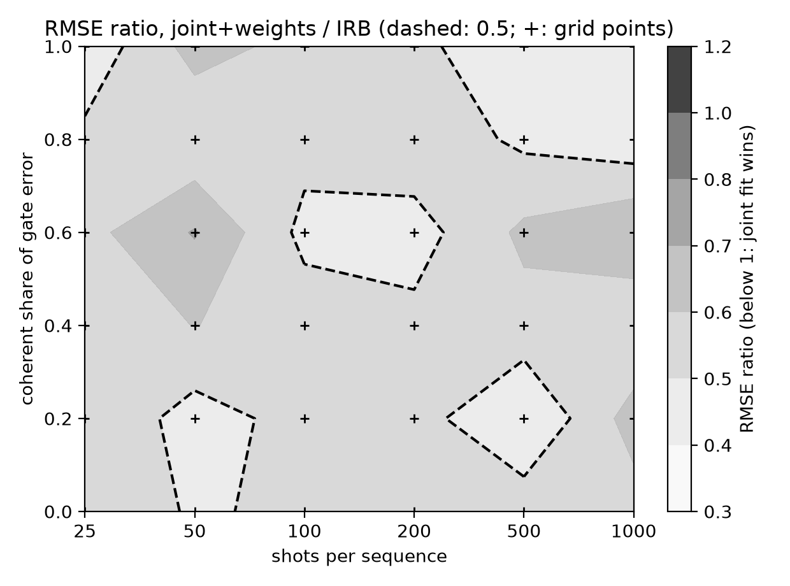
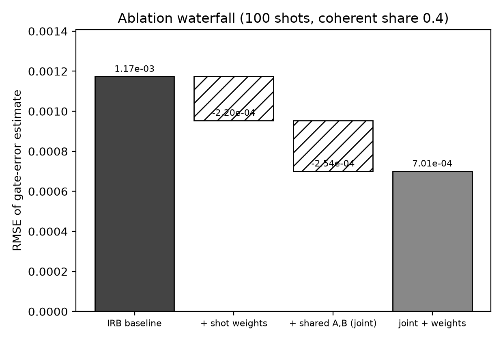
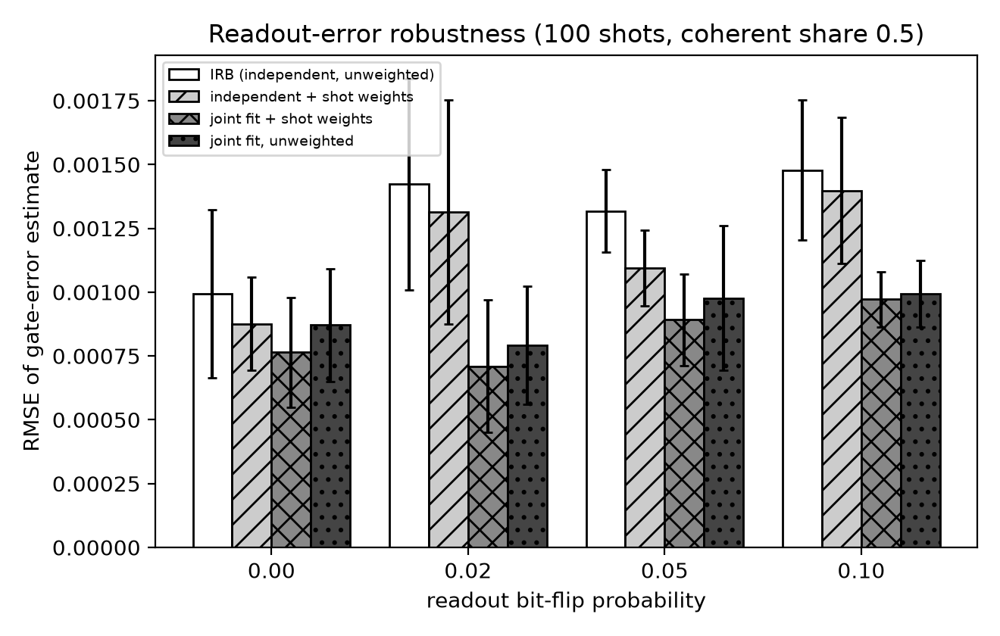
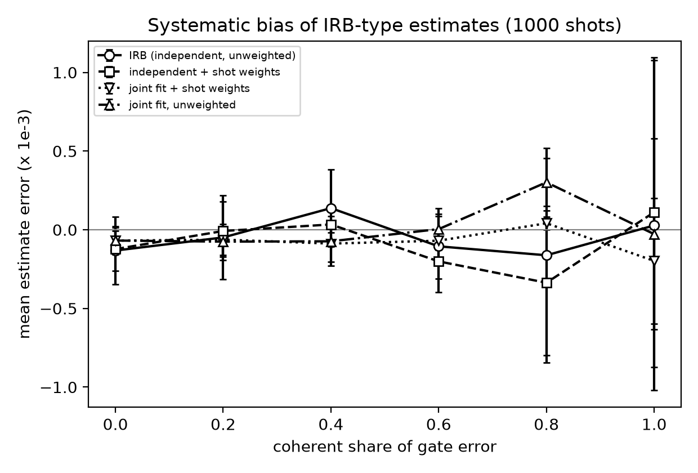
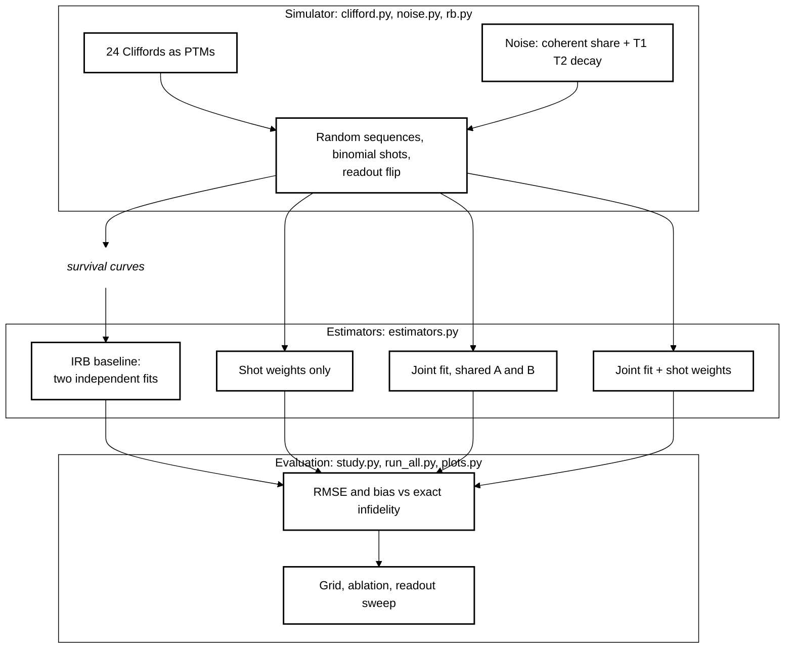

# Joint-Fit Interleaved Randomized Benchmarking under Coherent Error and Small Shot Budgets

[](LICENSE)

[](https://github.com/pradeepdegalaroyal/joint-fit-interleaved-rb-coherent-error/actions/workflows/ci.yml)

**Question.** At an equal shot budget, does fitting the reference and interleaved randomized-benchmarking (RB) curves
*jointly* (shared state-preparation-and-measurement (SPAM) offsets, binomial weights) estimate a single-gate error better than the textbook
two-independent-fits recipe, when part of the gate error is coherent?
**Answer (simulation).** Yes: in all 36 cells of a shots × coherent-share grid the joint weighted fit has a lower
root-mean-square error (RMSE), with a mean RMSE ratio of 0.536 (range 0.394–0.708). It does not remove the dependence on coherent share, and the
RMSE barely falls with more shots because the number of random sequences, not the shot count, is the limiting factor.

## Abstract

I simulate single-qubit interleaved RB with exact Pauli transfer matrices, a reference noise and an interleaved-gate noise
that mix a coherent over-rotation with energy-relaxation time (T1)/dephasing time (T2) decay at fixed total infidelity. The standard interleaved randomized benchmarking (IRB) estimator (two independent
exponential fits) is compared with a four-parameter joint fit with shared SPAM parameters and binomial shot weights, over
six shot budgets, six coherent shares, a readout-error sweep and an ablation, using 5 seeds. The joint weighted fit lowers
the estimator RMSE in 36 of 36 grid cells and in 176 of 180 seed-level comparisons. This is a simulation result with a
fixed, small number of sequences and no hardware data.

## Motivation and research gap

Recent experiments report logical qubits that beat their physical qubits and error rates below the surface-code
threshold (Acharya et al., 2023, digital object identifier (DOI) 10.1038/s41586-022-05434-1; Zobrist et al., 2025, DOI 10.1038/s41586-024-08449-y;
Sivak et al., 2023, DOI 10.1038/s41586-023-05782-6; Bluvstein et al., 2024, DOI 10.1038/s41586-023-06927-3).
Pre-fault-tolerant utility experiments also rely on cheap, repeated noise characterisation (Kim et al., 2023,
DOI 10.1038/s41586-023-06096-3), and new compilers consume per-gate fidelities as inputs
(Du et al., 2027, DOI 10.1016/j.future.2026.108830). The cited papers do not study how efficiently the
single-gate error is *estimated* from a small RB shot budget when errors are partly coherent. Details and a related-work
table are in [`docs/RESEARCH_GAP.md`](docs/RESEARCH_GAP.md).

## What is new here

- An equal-shot, paired comparison of independent and joint IRB fits over the shots × coherent-share plane.
- An ablation that splits the gain into "shot weights" and "shared SPAM parameters".
- A readout-error sweep showing that the joint fit degrades less than the independent fits.
- An honest negative result: the second half of the pre-registered hypothesis (the gain vanishes at high shots and
  fully coherent noise) is falsified.

## Results

All numbers below are in `results/` (`summary.csv`, `ratio_grid.csv`, `headline.json`, `raw_results.csv`).
RMSE is of `r_est - r_true` (true interleaved-gate infidelity 4e-3), mean over 5 seeds (8 repeated experiments each);
the per-cell std over seeds is in `summary.csv`.

| shots / sequence | coherent share | IRB RMSE (×1e-3) | joint + weights RMSE (×1e-3) | ratio |
|---|---|---|---|---|
| 25 | 0.0 | 1.38 | 0.75 | 0.543 |
| 25 | 0.4 | 1.63 | 0.88 | 0.538 |
| 25 | 1.0 | 4.02 | 1.71 | 0.426 |
| 100 | 0.0 | 0.67 | 0.34 | 0.512 |
| 100 | 0.4 | 1.17 | 0.65 | 0.554 |
| 100 | 0.6 | 1.91 | 0.90 | 0.472 |
| 1000 | 0.0 | 0.45 | 0.25 | 0.553 |
| 1000 | 0.4 | 0.93 | 0.47 | 0.502 |
| 1000 | 1.0 | 3.19 | 1.54 | 0.481 |

Readout-error sweep (100 shots, coherent share 0.5), RMSE ×1e-3 mean ± std over seeds: at 0 flip probability IRB
0.99 ± 0.33 versus joint 0.76 ± 0.22; at 0.10, IRB 1.48 ± 0.27 versus joint 0.97 ± 0.11.


*Fig. 1 — the joint weighted fit has a lower RMSE everywhere on the grid (ratio 0.39–0.71); the dashed line marks ratio 0.5.*


*Fig. 2 — at 100 shots and coherent share 0.4 the RMSE falls from 1.17e-3 to 7.0e-4; shot weights and shared SPAM parameters each contribute about 2.2e-4 to 2.5e-4.*


*Fig. 3 — the joint fits are less sensitive to readout error than the independent fits.*


*Fig. 4 — mean errors are within the seed scatter at 1000 shots, so the RMSE is variance-dominated, not bias-dominated.*

## Honest discussion

- **Hypothesis part 1 (≥ 20 % RMSE reduction at 100 shots, coherent share 0.5): supported.** The grid has no 0.5 point;
  the neighbours 0.4 and 0.6 give ratios of 0.554 and 0.472.
- **Hypothesis part 2 (ratio > 0.8 at 1000 shots, coherent share 1.0): falsified.** The ratio is 0.481. I expected bias from coherent error
  to dominate at high shots; instead the error is dominated by sequence-to-sequence variance, which the joint fit also reduces.
- IRB RMSE at coherent share 0.0 only drops from 1.38e-3 (25 shots) to 4.5e-4 (1000 shots), a factor of about 3 for 40× more shots,
  because the 12 sequences per length are fixed. More sequences, not more shots, would help.
- Coherent error raises the RMSE of both estimators (IRB 4.02e-3 at share 1.0 and 25 shots). The joint fit reduces but does not remove this.
- The comparison is paired, but the grid has 8 repeats × 5 seeds per cell, so single-cell ratios fluctuate (0.39–0.71); use the mean ratio 0.536.

## Limitations

Single qubit, gate-independent reference noise, one interleaved gate, exactly modelled channels and a bit-flip
readout; no leakage, crosstalk or drift. The analytic systematic-error bound for IRB is not evaluated. Only 12 sequences per
length were used. Nothing here is a hardware measurement or a claim of quantum advantage.

## Future work

Add the IRB systematic-error bound as a baseline; vary the number of sequences; extend to two qubits with a coupler
gate; use hardware calibration data on a superconducting or other device and feed the calibrated uncertainty into
a fidelity-weighted compiler; test leakage and non-Markovian drift.

## Method



*Diagram abbreviations: PTMs = Pauli transfer matrices.*

Every Clifford carries gate-independent reference noise (infidelity 3e-3, Z over-rotation plus T1/T2 decay with
T2 = 1.5 T1); the interleaved gate carries extra noise of infidelity 4e-3 (X over-rotation plus decay). The coherent share
moves the split at fixed total. Lengths are 1, 10, 25, 50, 100, 150, 200, 300 with 12 sequences each. Baseline: IRB
`r = (d-1)/d (1 - p_int/p_ref)` from two independent `A p^m + B` fits. Proposed: shared `A, B`, binomial
weights. See [`docs/METHOD.md`](docs/METHOD.md).

## Reproducibility

```bash
pip install -r requirements.txt && pip install -e .
python -m pytest -q
python experiments/run_all.py --quick   # smoke run, a few seconds (writes results_quick/, figures_quick/)
python experiments/run_all.py           # full study, 271.5 s (results/runtime.json)
```

Hardware: Windows 11, 16 threads, central processing unit (CPU) only, Python 3.11.9 (the full run took 271.5 s on a laptop shared with other work).

## Project structure

```
src/irbfit/      clifford.py noise.py rb.py estimators.py study.py
experiments/     run_all.py plots.py headline.py
tests/           test_irbfit.py
docs/            RESEARCH_GAP.md METHOD.md
results/         raw_results.csv summary.csv ratio_grid.csv headline.json runtime.json
figures/         fig1-fig4 (200 dpi)
```

## Related work by the author

- [repetition-code-breakeven-map](https://github.com/pradeepdegalaroyal/repetition-code-breakeven-map) — T1-limited break-even study for a bit-flip repetition code.
- [QEM-ZeroNoise-Extrapolation](https://github.com/pradeepdegalaroyal/QEM-ZeroNoise-Extrapolation) — zero-noise extrapolation.

## Citation

```bibtex
@software{degala_joint_fit_irb_2026,
  author   = {Degala, Chenchupradeep},
  title    = {Joint-Fit Interleaved Randomized Benchmarking under Coherent Error and Small Shot Budgets},
  year     = {2026},
  version  = {0.1.0},
  url      = {https://github.com/pradeepdegalaroyal/joint-fit-interleaved-rb-coherent-error},
  license  = {MIT}
}
```

Massachusetts Institute of Technology (MIT) license (`LICENSE`). See also `CITATION.cff`.
